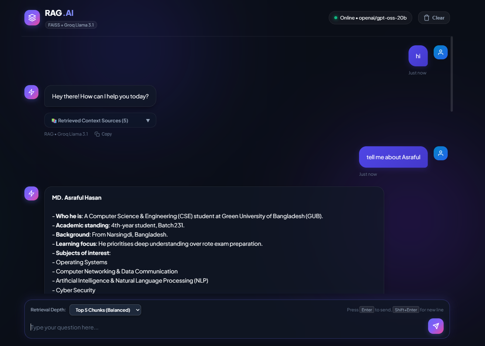
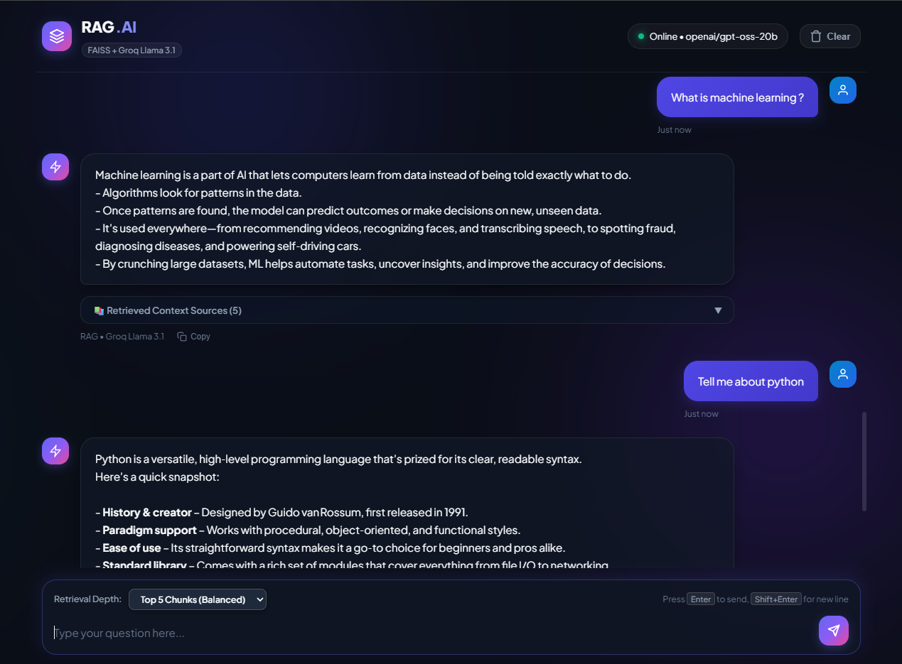
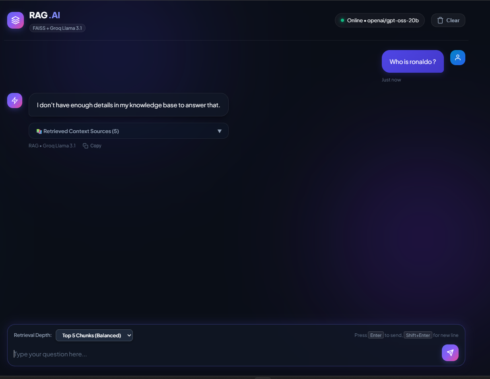

# 🧠 RAG.AI — Document Intelligence & Conversational Assistant

A high-performance, full-stack **Retrieval-Augmented Generation (RAG)** application that transforms your local documents into an interactive conversational AI. Powered by **FAISS** vector search, **Sentence-Transformers**, and ultra-fast inference via **Groq LLM**, featuring a modern **dark glassmorphism** web interface served seamlessly from a single FastAPI server.

---

## 📸 Visual Showcase

### 1. Real-Time Conversational Q&A & Source Citations
Natural, direct responses without robotic boilerplate phrasing, accompanied by collapsible document chunks and similarity distance metrics.



---

### 2. Technical Knowledge Synthesis & Formatting
Detailed extraction and structured formatting (bullet points, bold highlights) across multi-page technical documentation.



---

### 3. Out-of-Scope Fallback & Hallucination Prevention
Strict context adherence ensuring that queries outside the document corpus receive polite, honest conversational fallbacks instead of hallucinations.



---

## ✨ Features

- **Multi-Format Document Ingestion**: Ingests `.pdf`, `.txt`, `.csv`, `.xlsx`, `.docx`, and `.json` documents recursively from `data/`.
- **Fast Local Vector Search**: Local dense embeddings powered by `all-MiniLM-L6-v2` and indexed using FAISS `IndexFlatL2`.
- **Conversational Real-Time Persona**: Natural AI answers free from repetitive phrases like *"Based on the provided context"*.
- **Source Chunk Inspection**: Collapsible source citation drawer revealing exact retrieved chunks and their L2 distance scores.
- **Dynamic Retrieval Depth**: Interactive UI selector allowing users to choose between Top 3 (Fast), Top 5 (Balanced), or Top 8 (Deep) retrieval chunks.
- **Flexible Groq LLM Support**: Seamlessly switch between cutting-edge models (`openai/gpt-oss-20b`, `qwen/qwen3.8-27b`, etc.) via `.env`.
- **All-in-One Deployment**: FastAPI serves both the REST API and the static frontend assets from a single port (`8000`), eliminating CORS configuration hurdles.
- **Dark Glassmorphism Design**: Responsive UI featuring ambient glowing backdrops, auto-resizing input dock, quick prompt suggestion chips, and copy-to-clipboard toast notifications.

---

## 🏗️ Architecture

```
┌────────────────────────────────────────────────────────────────────────┐
│                        DATA INGESTION PIPELINE                         │
│                                                                        │
│   data/ ──────► src/data_loader.py ──────► src/embedding.py            │
│  (PDF/TXT/CSV/      (Recursive Loader)     (1000 char chunks,          │
│   XLSX/DOCX/JSON)                           200 char overlap,          │
│                                             all-MiniLM-L6-v2)          │
│                                                     │                  │
│                                                     ▼                  │
│                                           faiss_store/                 │
│                                        (faiss.index + metadata.pkl)    │
└────────────────────────────────────────────────────────────────────────┘
                                    ▲
                                    │ vector search
┌───────────────────────────────────┼────────────────────────────────────┐
│                         APPLICATION RUNTIME                            │
│                                   │                                    │
│  frontend/ (Web UI)               ▼                                    │
│   - HTML / CSS / JS   ◄───►  backend/main.py  ◄───►  src/search.py     │
│   - Port 8000 (Single        (FastAPI REST API)      (Groq Chat LLM)   │
│     Unified Server)                                                    │
└────────────────────────────────────────────────────────────────────────┘
```

1. **Ingestion**: Documents placed in `data/` are recursively parsed into LangChain documents.
2. **Chunking & Embedding**: Chunks are generated with a 1,000-character window and 200-character overlap, then embedded into 384-dimensional dense vectors.
3. **Indexing**: Embeddings and metadata are saved locally into `faiss_store/`.
4. **Query & Retrieval**: When a question is submitted, FAISS retrieves the top-$k$ nearest chunks.
5. **Synthesis**: Groq generates a concise, direct answer based strictly on the retrieved chunks.

---

## 📁 Project Directory Structure

```
RAG/
├── backend/
│   ├── __init__.py           # Backend package marker
│   ├── main.py               # FastAPI server, endpoints, and static file mount
│   └── schemas.py            # Pydantic request & response models
├── frontend/
│   ├── index.html            # Semantic chat interface markup
│   ├── style.css             # Dark glassmorphism theme and animations
│   └── app.js                # Client logic, fetch handling, DOM updates
├── src/
│   ├── __init__.py           # Source package marker
│   ├── data_loader.py        # Recursive loaders for PDF, TXT, CSV, DOCX, XLSX, JSON
│   ├── embedding.py          # Document chunking & sentence-transformer embeddings
│   ├── vectorstore.py        # FAISS vector store build, save, load, and query
│   └── search.py             # RAG retrieval and Groq chat synthesis
├── data/                     # Your local documents (PDF, TXT, DOCX, CSV, etc.)
├── faiss_store/              # Persisted FAISS index (faiss.index) and metadata.pkl
├── media/                    # Application screenshots and demo assets
│   ├── rag-1.png             # UI overview and Q&A showcase
│   ├── rag-2.png             # Technical question answering
│   └── rag-3.png             # Out-of-scope fallback handling
├── .env                      # Environment variables (API keys, models)
├── requirements.txt          # Python pip dependencies
├── pyproject.toml            # Project specifications & dependencies
├── uv.lock                   # Deterministic dependency lockfile
└── app.py                    # Standalone CLI testing script
```

---

## 🚀 Getting Started

### 1. Prerequisites
- **Python 3.10 to 3.13** installed
- A **Groq API Key** (Get one free at [console.groq.com](https://console.groq.com/keys))

---

### 2. Environment Setup

Clone the repository and open your terminal in the project directory:

```bash
cd f:\Projects\RAG-website\RAG
```

#### Windows (PowerShell):
```powershell
# Create virtual environment
py -m venv .venv

# Activate virtual environment
.\.venv\Scripts\Activate.ps1

# Install dependencies
pip install -r requirements.txt
```

> [!TIP]
> If PowerShell shows an execution policy error, run:
> ```powershell
> Set-ExecutionPolicy -ExecutionPolicy RemoteSigned -Scope Process
> ```
> then run `.\.venv\Scripts\Activate.ps1` again.

#### Windows (Command Prompt / CMD):
```cmd
# Create virtual environment
python -m venv .venv

# Activate virtual environment
.\.venv\Scripts\activate.bat

# Install dependencies
pip install -r requirements.txt
```

#### Using `uv` (Fast alternative):
```powershell
uv sync
.\.venv\Scripts\Activate.ps1
```

---

### 3. Configure Environment Variables (`.env`)

Create or update a `.env` file in the root folder:

```env
GROQ_API_KEY="your_groq_api_key_here"
GROQ_MODEL="openai/gpt-oss-20b"
```

> [!NOTE]
> Supported models on Groq include `openai/gpt-oss-20b`, `qwen/qwen3.8-27b`, `openai/gpt-oss-120b`, and `llama-3.3-70b-versatile`. You can change models anytime in `.env` without modifying code.

---

### 4. Build or Rebuild Document Index

To index all documents in the `data/` folder:

```powershell
python -c "from src.data_loader import load_all_documents; from src.vectorstore import FaissVectorStore; docs = load_all_documents('data'); FaissVectorStore('faiss_store').build_from_documents(docs)"
```

*(If `faiss_store/` is missing on first launch, the server will automatically build it from `data/` on startup).*

---

### 5. Run the Application

Start the FastAPI application:

#### In PowerShell:
```powershell
uvicorn backend.main:app --host 127.0.0.1 --port 8000 --reload
```

#### In Command Prompt (CMD):
```cmd
uvicorn backend.main:app --host 127.0.0.1 --port 8000 --reload
```
*Or without activation:*
```cmd
.\.venv\Scripts\python.exe -m uvicorn backend.main:app --host 127.0.0.1 --port 8000 --reload
```

---

### 6. Access the Website

Open your browser and navigate to:

👉 **[http://localhost:8000](http://localhost:8000)**

You will see:
- Real-time indicator: **`🟢 Online • openai/gpt-oss-20b`**
- Ready-to-use prompt suggestion chips
- Chat window with full conversation history and source citations

---


### 7. Ask Question
Submit a query for vector retrieval and LLM answer synthesis.

```http
POST /api/ask
Content-Type: application/json
```

**Request Body**:
```json
{
  "question": "What is machine learning?",
  "top_k": 5
}
```

**Response (`200 OK`)**:
```json
{
  "question": "What is machine learning?",
  "answer": "Machine learning is a part of AI that lets computers learn from data instead of being told exactly what to do...",
  "sources": [
    {
      "index": 4,
      "distance": 0.3128,
      "text": "Machine learning algorithms build a mathematical model based on sample data..."
    }
  ]
}
```

---

## 🔧 CLI Testing (Without Web Server)

You can also query the vector store and test RAG answers directly from the terminal:

```powershell
python app.py
```

---

## 🛠️ Troubleshooting

| Issue | Cause | Solution |
| --- | --- | --- |
| **"Backend offline" badge in UI** | Server is not running on port 8000 | Run `uvicorn backend.main:app --host 127.0.0.1 --port 8000` |
| **PowerShell script execution disabled** | Windows security policy blocks scripts | Run `Set-ExecutionPolicy -ExecutionPolicy RemoteSigned -Scope Process` |
| **Groq 404 Model Not Found** | Model name deprecated or inaccessible on key | Update `GROQ_MODEL=openai/gpt-oss-20b` in `.env` |
| **New documents not appearing in answers** | FAISS store has not been updated | Rebuild the index using the command in Step 4 and restart server |
| **Port 8000 already in use** | An existing background server is running | Kill the previous process or run on port 8001: `--port 8001` |

---
